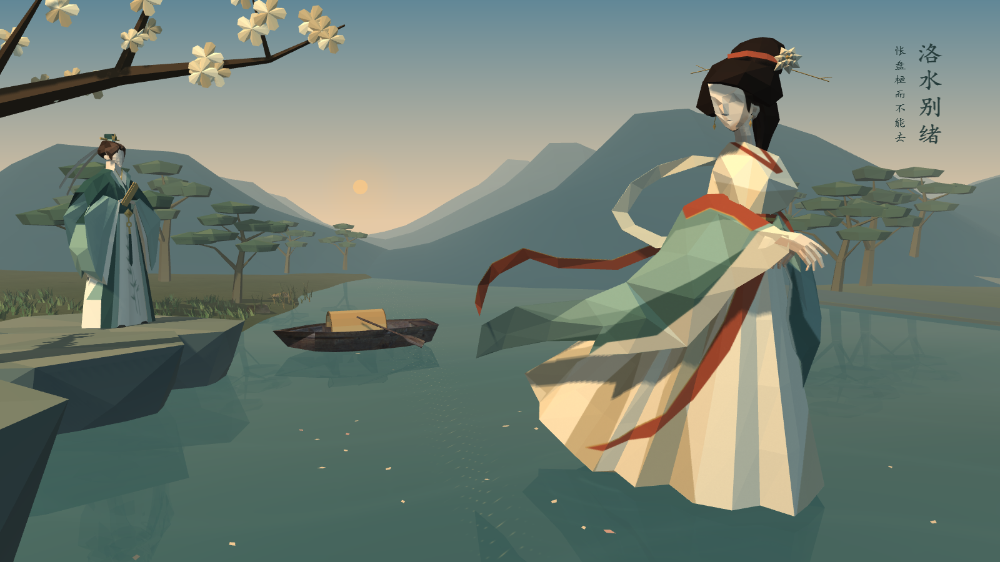

# 洛水别绪 · 洛神赋 OpenGL 小组作业

《洛神赋》计算机图形学小组作业，使用 C++17 和 OpenGL 实时渲染。曹植立于左岸，洛神在右侧水面回望，小舟停在岸边。主分支提供可交互的静态场景，已接入 OBJ/MTL 模型、贴图、Phong 光照、阴影、水面和倒影。



## 从这里开始

1. 安装 Visual Studio 的“使用 C++ 的桌面开发”与 Windows SDK。
2. 克隆仓库后，在 PowerShell 执行 `./scripts/build.ps1`。脚本查找 MSBuild，选择 v143 或 v145 工具集。
3. 执行 `./scripts/check.ps1` 检查模型、贴图和路径数学。
4. 双击根目录“打开洛水别绪.cmd”，或运行“场景工程_美术重制/bin/LuoshenScene.exe”。

也可在 Visual Studio 打开 `场景工程_美术重制/LuoshenScene.vcxproj`，选择 **Release / x64**，按 **Ctrl+F5** 运行。VS 2022 使用 v143 工具集。首次从项目文件打开时，可保存 Visual Studio 生成的解决方案，之后直接打开该解决方案。运行需要 Windows x64，以及支持 OpenGL 2.1、深度纹理和帧缓冲对象的显卡驱动。

## 目录

| 路径 | 用途 |
|---|---|
| 场景工程_美术重制/ | 唯一维护的C++场景工程，assets为实际运行素材 |
| assets/caozhi-current/caozhi.blend | 最终曹植可编辑工程 |
| assets/luoshen-current/luoshen.blend | 最终洛神可编辑工程 |
| scripts/ | 构建与检查入口 |
| [协作说明.md](协作说明.md) | 四人分工、分支及合并流程 |
| 场景工程_美术重制/素材来源与许可.md | 素材及依赖来源 |
| references/papercraft/target.png | 美术参考，不参与运行 |

人物工程已包含，无需旧压缩包或Blender即可编译运行。编辑人物时自行安装Blender；本机便携软件与编译缓存不提交Git。

## 修改入口

| 内容 | 文件（位于场景工程_美术重制） |
|---|---|
| 布局、角色朝向与比例、相机 | main.cpp |
| 主镜头和人物/舟/岩岸的集中布局参数 | scene_layout.h |
| 光照、雾、水纹、贴图 | graphics_support.h |
| 阴影 | shadow_map.h |
| 洛神路径、朝向、小舟微动与叙事时间轴 | scene_motion.h |
| 披帛逐顶点变形（肩边固定、根到梢行波） | pibo_motion.h |
| 花瓣与环境动态 | environment_effects.h |
| OBJ/MTL读取 | mesh_data.h |
| 题款与提示 | scene_overlay.h |

世界坐标以 Y 轴向上，水面为 Y = 0。人物和景物以包围盒底部为摆放基准。

## 操作

左键旋转，右键平移，滚轮缩放；WASD移动观察中心；1/2/3/4切换主视/全景/洛神/曹植；空格暂停/继续叙事动画，R重置到起点与主镜头；Tab进入摆放模式，Ctrl+S保存布局，H帮助，F9截图，Esc退出。

`./scripts/check.ps1 -Capture`在真实图形环境中生成主镜头、全景、洛神和曹植四张静态截图。作业演示视频由小组自行录制。角色动画的分段截图与 45 秒连续帧入口见 [docs/narrative-animation.md](docs/narrative-animation.md) 与[验收报告](docs/角色与叙事动画实现与验收报告.md)。

```powershell
场景工程_美术重制\bin\LuoshenScene.exe --capture-farewell        # 11 个时间点
场景工程_美术重制\bin\LuoshenScene.exe --capture-farewell-video  # 45 秒 @30fps
```

## 四人分工

| 负责范围 | 本轮任务 |
|---|---|
| 布局与镜头 | 调整人物、树石、小舟和镜头，统一接入各模块 |
| 光照与材质 | 夕照、Phong 光照、阴影和雾气 |
| 角色与叙事动画 | 依次实现洛神沿 Bézier 曲线离去、披帛轻摆、小舟微动 |
| 环境动态 | 花瓣飘落和漂浮、涟漪、动态水纹 |

组员可从 `main` 分别开分支。任务顺序、文件边界、统一播放时间和验收要求见[协作说明](协作说明.md)。

## 场景版本

`main` 是小组并行开发的静态基线。新版曹植及左岸布局见 [#4](https://github.com/NEMU-CAN/luoshen-opengl-coursework/pull/4)，六块新岩石的衔接方案见 [#5](https://github.com/NEMU-CAN/luoshen-opengl-coursework/pull/5)。角色动画和环境动态按协作说明分模块开发。

第三方素材、人物资产和源码不共用同一许可；请阅读来源说明。本仓库未额外授予项目源码或人物资产的开源许可。
