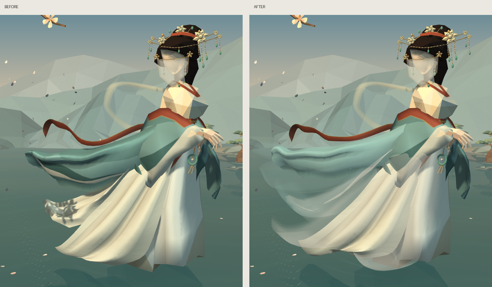
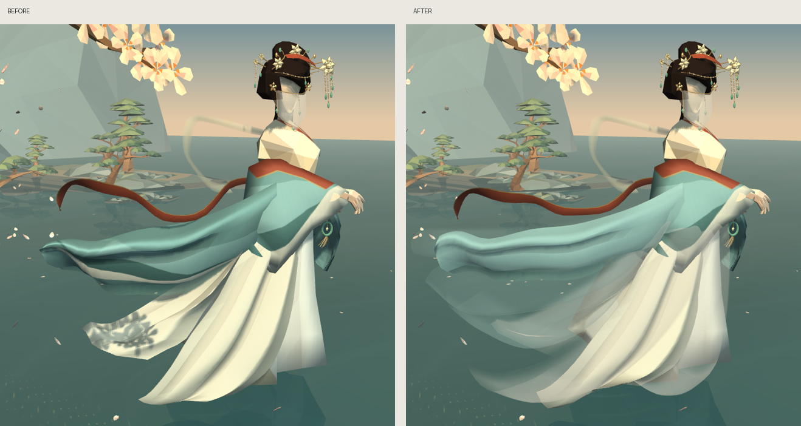
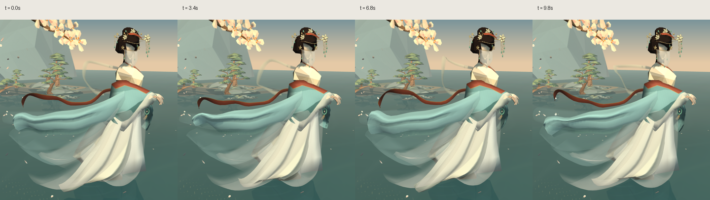

# 洛神衣物轻纱试版

收窄原青色外袖，增加两片袖纱和三片裙纱，将原上裙调整为半透明外层，错开裙边高度与前后间距。新衣层使用独立青色/象牙白细纹贴图、透明边缘过渡和具有相位差的行波。

本轮基于 `b31f01f`（头饰、面纱与连续岩岸版本）。修改 7 个已有衣物对象并新增 5 个薄纱对象，其余 313 个原 OBJ 对象逐块字节一致。具体范围见 [scope-verification.json](scope-verification.json)。运行时 OBJ/MTL 已更新；根目录的 Blender 源工程未同步。

## 实际运行截图

同镜头裁切，左为改前，右为改后：

## 验证

- Visual Studio Release/x64：`scripts/build.ps1` 成功。
- 随后运行 `scripts/check.ps1 -Capture`：模型与数学检查全部通过，48 个资产、600373 个三角面；四视角实际渲染 `GL error=0`。
- `LuoshenScene.exe --capture-cloth side`：50 帧、0–9.8 秒，`GL error=0`。上图采样 0、3.4、6.8、9.8 秒。
- `git diff --check` 通过。
- 本机 MSBuild 环境存在代理变量大小写重复；构建时仅在子进程中将环境键转为大写并设置 `MSBUILDDISABLENODEREUSE=1`，未修改系统环境。

## 已知不足

近手袖口仍偏厚，少数透明纱片交界可见折线，右侧内裙仍稍显直垂。透明衣层沿用按材质批次中心排序；已查看上述主/侧面和运动采样，尚未验证所有相机转角及最大风力下的交叠。
