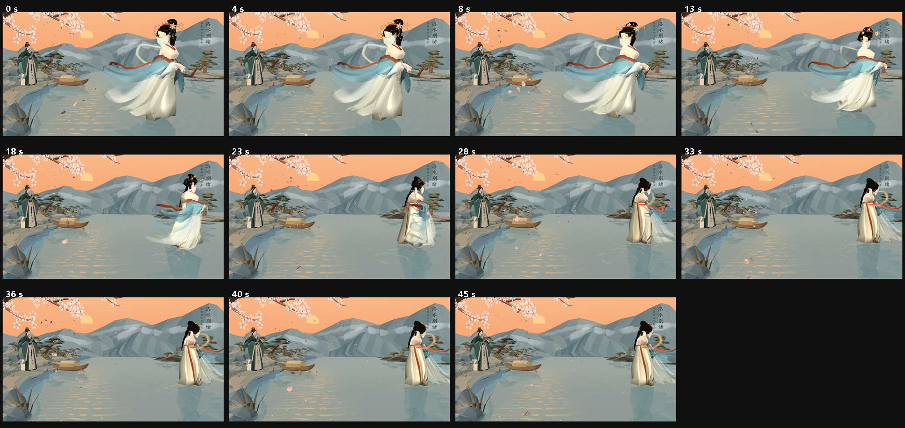

# 角色与叙事动画模块说明

本模块负责洛神沿三次 Bézier 曲线离去、披帛轻摆与小舟微动。所有姿态都是统一动画时间 `animationTime` 的纯函数，暂停、重播和结束停留不需要额外状态。



## 1. 叙事时间轴（45 秒）

| 时间 | 段落 | 画面事件 |
|---|---|---|
| 0–4 s | 静立回望 | 洛神停在静态站位 `(1.00, 0.045, -1.20)`，披帛只有极轻的起风，小舟开始缓慢起伏 |
| 4–34 s | 沿曲线离去 | 梯形速度曲线起步，沿三次 Bézier 曲线向右前方开阔水面移动，同时缓慢转向路线方向 |
| 34–45 s | 终点停留 | 位置和朝向精确停在曲线终点，披帛回落到安静幅度，小舟继续微动 |

时间到曲线参数的映射不使用简单的 `smoothstep(时间)`，而是对“加速—匀速—减速”的速度曲线积分后再归一化：

```text
u = clamp((t - 4) / 30, 0, 1)
v(u) = 加速段 / 匀速段 / 减速段，两端速度为 0
曲线参数 = ∫v du / ∫v du|0..1
```

这样既保留“起步前的停顿”和“到点停稳”，又不会让 45 秒演示的前十几秒几乎看不出移动。起步后速度基本稳定在 `0.13–0.16` 世界单位/秒之间（8 秒前后最快，约 `0.162`）。

## 2. 洛神离去

### 2.1 三次 Bézier 控制点

| 控制点 | 坐标 (x, y, z) | 说明 |
|---|---|---|
| P0 | `(1.000, 0.045, -1.200)` | 与 `scene_layout::luoshenPosition` 完全一致 |
| P1 | `(2.300, 0.045, -1.700)` | 先向画面右侧展开，让位移在镜头里可见 |
| P2 | `(3.400, 0.045, -2.450)` | 继续向右前方，只略微后退 |
| P3 | `(4.450, 0.045, -2.800)` | 右前方开阔水面，仍在画面内，不越过右岸 |

曲线长度约 `3.81` 世界单位。主镜头下起点位于屏幕约 `(993, 751)`，终点约 `(1450, 654)`，人物高度从约 677 像素缩小到约 513 像素：既有明确的横向位移，也保留一点远去感。

### 2.2 朝向

模型默认面向 `+Z`，初始站位 `yaw = -25°`。离去时朝向与曲线参数同步插值到 `108°`，即角色缓慢转身、朝右前方走去，不再原地打转。转向与位移共用同一条缓动曲线，所以起步和停止时角速度也为 0；0.01 秒采样下的最大角度步进约 `0.052°`，不存在跳变。

### 2.3 路线约束

自动测试在整条曲线上以 0.05 秒采样，检查：

- 始终位于左岸线 `shoreline(z) + 0.55` 以外；
- `x < 8.0`，不进入右岸与远景山体；
- 与小舟水平距离大于 `1.2`；
- `y` 始终为 `0.045`，贴水面移动。

## 3. 披帛变形

披帛没有重新建模，也没有改材质，只对已有顶点做局部变形。模块位于 `pibo_motion.h`，覆盖以下材质批次：

| kind | 材质 | 作用 |
|---|---|---|
| 8 | `Wind_RedRibbon`、`Wind_RedEdge` | 自肩头向右后方延伸的红色飘带与红边 |
| 9 | `Wind_GoldPibo` | 沿肩颈一圈的金色披帛 |
| 26–29 | `Drape_JadeSilk`、`Drape_IvorySilk*` | 披帛主体的四层玉色/象牙色垂纱 |

### 3.1 参数化

每个顶点的变形量是静止坐标与时间的解析函数：

```text
offset = A * w(s) * [ D·sin(φ) + L·sin(0.61φ + 1.2) + U·sin(φ + 0.55) ]
φ      = 1.08 t - λ(s)
```

- `s`：根部到末端的归一化参数。kind 8 沿 X 从肩头到飘带末端；kind 9 沿 Y 从肩线到披帛最低点；kind 26–29 使用 Blender 导出的 V 坐标（0.88 为肩部接缝）。
- `w(s)`：摆幅权重，根部恒为 0，中段轻摆，末端最大（kind 8 为 `s^1.55`；垂纱为 `s²·(0.55 + 0.9·free)`）。
- `λ(s)`：相位滞后，越靠末端越晚，形成由根到梢传播的行波，而不是整片同相位平移。
- `A`：各材质基础摆幅，`0.024–0.060` 模型单位；乘人物缩放 1.86 后末端约 4.5–16 cm。
- 方向：`D` 为相对风方向（人物前进的反方向），`L` 为横向，`U` 为竖向。

肩部接缝处 `w(0) = 0`，所以起点固定、不会脱肩；相位滞后保证末端比中段晚到峰值。测试对六种材质逐一检查了根部零位移、末端摆幅大于中段、末端峰值时间晚于中段。

### 3.2 与着色器的分工

主分支里披帛原本由顶点着色器的 `materialKind==8/9/26..29` 分支做位移。接入本模块后，这几类批次的 `clothMotionEnabled` 被置 0，位移完全由 `pibo_motion.h` 负责，避免两层摆幅叠加；袖子、裙摆等其他布料仍由原有着色器分支驱动，`graphics_support.h` 未改动。

每帧只更新披帛批次的 VBO（约 4.5 万顶点，约 1.4 MB），阴影、倒影和正片共用同一份数据，因此三处姿态天然一致。默认 60 FPS 垂直同步下没有可见性能下降。

## 4. 小舟微动

小舟以当前泊位 `(-3.24, 0.025, -8.29)` 为基准，只做四个自由度的小幅运动：

```text
heave = 0.018 sin(0.72t) + 0.006 sin(0.33t)
roll  = 1.05° sin(0.55t)
pitch = 0.55° sin(0.81t)
yaw   = 0.45° sin(0.47t)
```

四个周期互不相同（8.7 s / 11.4 s / 7.8 s / 13.4 s），避免机械同步；`t=0` 时全部为 0，所以重置后与布局中的泊位完全一致。

按船体 1.89 万顶点逐帧计算：船底最低点在水面下最多约 `4.2 cm`、在水面上最多约 `3.6 cm`，相对 2.05 m 的船体高度不到 2%，视觉上保持“船底贴水”。横摇、纵摇的转动中心在船底中心，船身不会横向穿入左岸。

## 5. 主程序接口

`main.cpp` 中新增的接入点：

- `scene_motion::farewell(animationTime)`：返回位置、朝向、速度、曲线参数和段落编号。
- `scene_motion::boatMotion(animationTime)`：返回升沉、艏摇、纵摇、横摇。
- `scene_motion::windEnvelope(animationTime)`：披帛风场强度，开场平静、行进时加强、到点后回落。
- `pibo_motion::displacement(kind, position, uv, time, strength)`：单顶点位移。
- `updatePiboDeformation(luoshen, time, wind)`：把变形后的顶点写回 VBO。

绘制时，洛神的 `drawEditable` 用离去姿态替换静态 `pose.position / pose.yaw`；小舟在 `pose.position.y` 上叠加升沉、在 `pose.yaw` 上叠加艏摇，并把纵摇/横摇传给 `drawModel` 的 `tilt` 参数。阴影、倒影、正片和披帛半透明层共用这些姿态。按 3 号镜头时目标点跟随洛神当前位置。

暂停与重置沿用主程序已有的统一时钟：空格只停止 `animationTime` 累加，三个模块同时冻结；R 把时间归零，洛神回到起点、披帛回到静止形态、小舟回到泊位。

## 6. 演示与截图入口

| 命令（在 `场景工程_美术重制/bin` 下） | 输出 |
|---|---|
| `LuoshenScene.exe` | 交互演示，空格暂停，R 重置 |
| `LuoshenScene.exe --capture-farewell` | 45 秒中 11 个时间点的分段截图，`captures/farewell/` |
| `LuoshenScene.exe --capture-farewell-still` | 同一时间点、披帛静止的对照图，`captures/farewell-still/` |
| `LuoshenScene.exe --capture-pibo` | 披帛近景 7 帧，`captures/pibo/` |
| `LuoshenScene.exe --capture-boat` | 小舟近景 8 帧，`captures/boat/` |
| `LuoshenScene.exe --capture-farewell-video [帧数]` | 30 fps 连续帧，默认 1350 帧（45 秒），`captures/farewell-video/` |

连续帧可用 ffmpeg 合成：

```powershell
ffmpeg -framerate 30 -i captures/farewell-video/frame-%04d.bmp `
       -c:v libx264 -preset medium -crf 18 -pix_fmt yuv420p -movflags +faststart farewell-45s.mp4
```
