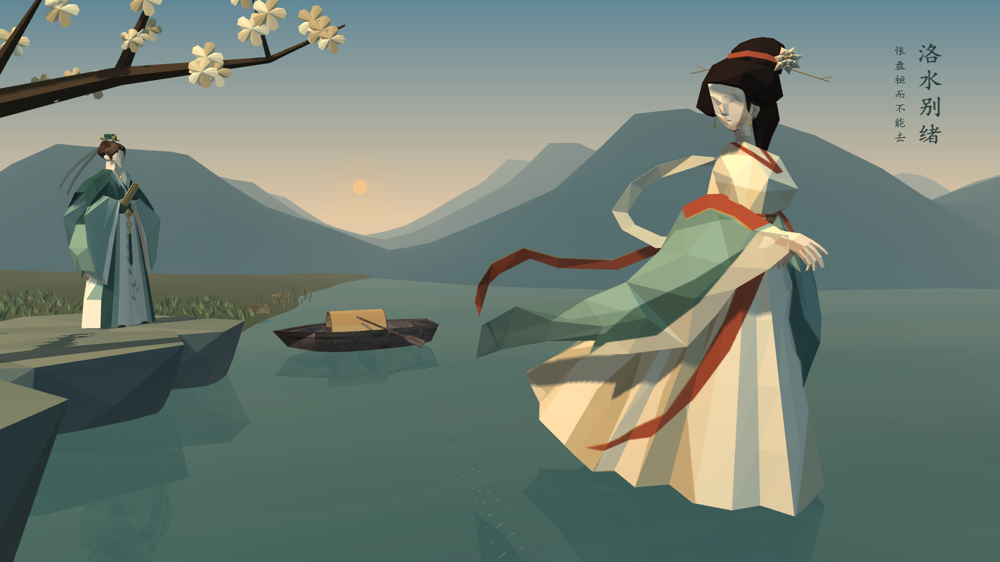

# 参考图构图小样

依据用户参考图：洛神右侧近景，曹植左岸远景，中间留水面与舟，左上花枝形成框景。重点是远近层次和视觉联系，不宣称复制概念图的材质和照明。

## 修改入口

`场景工程_美术重制/scene_layout.h` 集中主相机、人物大小和朝向、舟、花树及岩岸的位置。人物网格、材质和纹理保持原样。

| 内容 | 本轮变化 |
|---|---|
| 主镜头 | 低机位近景；离别过程中缓慢拉远并向右转移观察中心 |
| 曹植 | 退到左岸岩台，朝右面向洛神 |
| 洛神 | 保留原路径，增加近景视觉比重；头顶和裙底留空间 |
| 岩岸与草丛 | 增加折面岩岸，减少碎石和密集草丛 |
| 树木 | 左上花枝框景，写实树退远 |
| 舟 | 缩小并移至中景，增加独立舟篷 |
| 远山 | 减少网格密度，整理山峰、山谷和折面轮廓 |

鼠标旋转/平移、滚轮或WASD操作后，默认镜头的自动拉远停止，交由操作者自由观察。1或R恢复主镜头；R同时重置动画。贝塞尔控制点、45秒时长、人物摆姿和光照着色器均未改动。

## 原创框景素材

`scripts/generate_composition_assets.py` 使用Python标准库生成真实OBJ/MTL，无外部下载：blossom-frame疏枝与折面花、river-ledge岩岸、boat-canopy拱形舟篷。文件位于场景assets/luoshen-environment/composition，舟篷随原舟轻摇。

## 检查与边界

本机重编、读取和6张实际帧缓冲截图通过，GL错误0。已查看主视、全景、22.5秒和45秒，主视中的人物不裁切。两个人物源文件和运行素材相对基线无修改。

本地若保留3艘备用舟，共检查16个OBJ；协作仓库包含13个。脚本依据实际数量读取全部素材。

[修改前后对照](composition-study/comparison.png)。花朵与岩岸仍简化；暖夕照、水面、云雾及倒影质感尚未按参考图重做。本轮不改人物脸型和头发。
